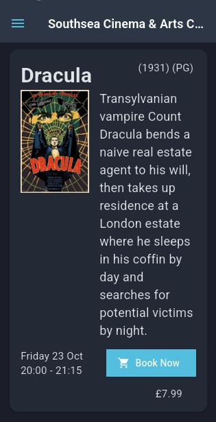
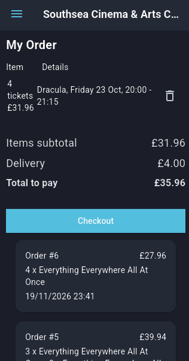

# Southsea Cinema

Southsea Cinema is a Flutter app for viewing films and adding tickets to an order. It currently supports Android devices and Android emulators only.

## Features

- View films loaded from a bundled JSON file.
- Open a film to see its poster, description, age rating, date and time.
- View basket totals, remove items and complete checkout.
- Save and view bookings using a local SQLite database.
- Save customer profile settings and choose light or dark mode.

## Screenshots

### Home view



### Basket



## Project file structure

The main project folders are:

```text
southsea_cinema/
├── assets/
│   ├── data/        # Film data stored as JSON
│   └── images/      # Film posters
├── lib/
│   ├── database/    # SQLite database setup and bookings
│   ├── models/      # App data types
│   ├── repositories/  # Loading films and managing the basket
│   ├── views/       # Application screens
│   └── widgets/     # Shared interface components
├── test/
│   ├── database/    # Database tests
│   ├── models/      # Model tests
│   ├── repositories/# Repository tests
│   ├── views/       # View tests
│   └── widgets/     # Widget tests
└── pubspec.yaml     # Project dependencies and assets
```

## Install dependencies

Make sure Flutter is installed and connected to an Android emulator or device.

From the project folder, run:

```bash
flutter pub get
```

## Run on an Android emulator

Start an Android emulator, then check that it is available:

```bash
flutter devices
```

Run the app:

```bash
flutter run -d [device-name]
```

Replace `[device-name]` with the device ID shown by `flutter devices`, if it is different.

The app shows an unsupported-platform message outside Android, including on the web.

## Run the tests

An Android emulator is not needed to run the tests. The tests run locally on the development machine.

Run all tests from the project folder:

```bash
flutter test
```

To measure test coverage, run:

```bash
flutter test --coverage
```

This creates a `coverage/lcov.info` file. Open this file in a coverage tool or VS Code extension that supports LCOV reports to view which lines of code are covered by the tests.
